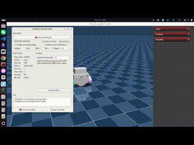

# legged_mujoco

The architecture is the same as [unitree_mujoco](https://github.com/unitreerobotics/unitree_mujoco). 

## Dependencies

- Ubuntu 24.04
- mujoco 3.13.0

  ```bash
  git clone https://github.com/google-deepmind/mujoco.git && cd mujoco
  # checkout out to the specified version
  git checkout  3.13.0
  mkdir build && cd build
  cmake .. -DCMAKE_BUILD_TYPE=Release -DCMAKE_INSTALL_PREFIX=/usr/local -DCMAKE_C_COMPILER=/usr/bin/gcc-13 -DCMAKE_CXX_COMPILER=/usr/bin/g++-13 # specify gcc-13 if multiple versions of gcc are installed
  make -j$(nproc)
  sudo make install
  ```
- gcc-13

## Installation

- Clone this repository to your local machine

  ```bash
  git clone https://github.com/lupinjia/legged_mujoco.git
  ```

- Compile the code

  ```bash
  # If you have activated a conda environment, deactivate it first to avoid compilation errors
  conda deactivate

  cd legged_mujoco/simulate
  mkdir build && cd build
  cmake ..
  make
  ```

## Features

- Add support for Yahboom USB wireless joystick and betop USB joystick (C++)

  Added joystick mapping code (simulate/src/physics_joystick.h) according to the proxy of [Yahboom USB Wireless Joystick](https://yahboom.com/study_module/PS2) and betop USB joystick

  Change the `joystick_type` in `simulate/config.yaml` to other values if you want to use joystick of other types

- Keyboard teleop (no gamepad needed)

  Set `use_joystick: 1` and `joystick_type: "keyboard"` in `simulate/config.yaml`. Held keys are read by
  `simulate/src/keyboard_joystick.h` (a `GlfwAdapter` subclass), so it works while the viewer has focus.
  Default mapping:

  | input | keys |
  | ----- | ---- |
  | left stick (`lx`/`ly`) | `A`/`D` (left/right), `S`/`W` (back/forward) |
  | right stick (`rx`/`ry`) | `J`/`L`, `K`/`I` |
  | d-pad (`left`/`right`/`up`/`down`) | arrow keys |
  | buttons | `Space`=A, `Left Shift`=B, `Q`=X, `E`=Y, `1`=L1, `2`=R1, `3`=start, `4`=select |

  Edit `update()` in `simulate/src/keyboard_joystick.h` to remap. Note the arrow Left/Right keys are also
  MuJoCo's step-forward/back shortcuts.

- Press `Enter` to track base_link of the robot, press `Esc` to use free camera (only in C++)

## URDF to MuJoCo

The `urdf2mjcf` helper converts a URDF robot description to MuJoCo MJCF. See
[`urdf2mjcf/README.md`](urdf2mjcf/README.md) for installation, command-line options,
and an example. The converter can create a robot directory under `robots/<name>/`;
review and refine the generated MJCF manually where needed. Mesh files are resolved
from the URDF's mesh paths, and this repository does not include N1 robot assets.

## Demo


